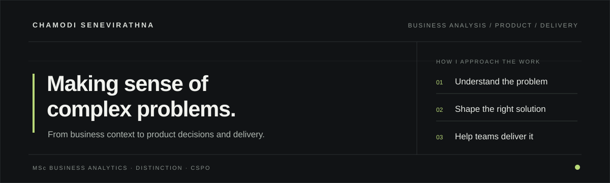

<!-- Chamodi Senevirathna | Profile -->

  

Most of my work starts with a practical question: what is actually getting in the way, and what would make it better?

I came to this through software engineering, then moved into business analysis, product work and business analytics. That path means I look at problems from both sides: the business process and the technology being built. I enjoy understanding how people work, making requirements concrete, weighing trade-offs and helping teams turn decisions into something useful.

My projects reflect that mix. Some explore product opportunities and business workflows; others are hands-on technical experiments, including one that uses a fruit-fly connectome to investigate whether a simplified neural model can learn a tiny Sudoku task. Different subjects, same habit: test the idea, examine the result and be clear about what the evidence does and doesn't show.

---

## A selection of things I've been working on

The projects below are grouped by the kind of question behind them, not by technology stack.

### Business, customers & operations

<table>
  <tr>
    <td width="100%" valign="top">
      01 / GO-TO-MARKET SYSTEMS  
      <strong><a href="https://github.com/chamodiHsenevirathna/autonomous-gtm">Autonomous GTM — from first enquiry to thoughtful follow-up</a></strong>  
      What if lead research, qualification, CRM updates and follow-ups worked as one connected process? This simulated end-to-end case study explores that workflow, with agents preparing the work and people approving consequential actions.  
      GTM operations · Process design · Human oversight · Auditability
    </td>
  </tr>
</table>

### Product questions worth investigating

<table>
  <tr>
    <td width="50%" valign="top">
      02 / HEALTHCARE · PRODUCT STRATEGY  
      <strong><a href="https://github.com/chamodiHsenevirathna/healthcare-ai-case-study">When AI predictions don't pay</a></strong>  
      A model can predict readmission risk. Can a hospital act on it, and does the economics make sense for the organisation paying?  
      Business viability · Incentives · Operational fit
    </td>
    <td width="50%" valign="top">
      03 / FINANCIAL SERVICES · PRODUCT DISCOVERY  
      <strong><a href="https://github.com/chamodiHsenevirathna/digital-financial-document-intelligence">Beyond chat with PDFs</a></strong>  
      Financial analysis needs more than a fluent answer. This research explores where document AI loses structure, evidence and trust.  
      Workflow analysis · Problem framing · Evaluation
    </td>
  </tr>
  <tr>
    <td width="50%" valign="top">
      04 / HEALTH TECHNOLOGY · OPPORTUNITY ASSESSMENT  
      <strong><a href="https://github.com/chamodiHsenevirathna/digital-twin-oncology-case-study">Beyond trial and error</a></strong>  
      Which oncology use cases have enough evidence, a credible validation path and a reason to become a product?  
      Use-case prioritisation · Stakeholders · Risk
    </td>
    <td width="50%" valign="top">
      05 / CONSUMER · PRODUCT DEFINITION  
      <strong><a href="https://github.com/chamodiHsenevirathna/local-first-reader-case-study">A local-first reading experience</a></strong>  
      Could a private, account-free reading experience be compelling enough to justify building? The research narrows the opportunity before committing to a build.  
      Product research · MVP scope · Feasibility
    </td>
  </tr>
</table>

### Things I built or tested

<table>
  <tr>
    <td width="50%" valign="top">
      06 / PRODUCT PROTOTYPE  
      <strong><a href="https://github.com/chamodiHsenevirathna/brickwise">Brickwise</a></strong>  
      A working local prototype for visual product discovery. It learns from Like / Pass feedback to shape recommendations, rather than asking people to describe their taste in filters.  
      Product experience · Personalisation · Experimentation
    </td>
    <td width="50%" valign="top">
      07 / NEUROSCIENCE × COMPUTING  
      <strong><a href="https://github.com/chamodiHsenevirathna/flyoku">Flyoku — can a tiny brain learn Sudoku?</a></strong>  
      A playful experiment using a real fruit-fly connectome and a simplified neural simulation to test whether a tiny readout can learn a small pattern task. The result is as interesting for what it cannot learn as for what it can.  
      Curiosity project · Simulation · Experimental design
    </td>
  </tr>
  <tr>
    <td width="50%" valign="top">
      08 / MEDICAL AI · EVALUATION  
      <strong><a href="https://github.com/chamodiHsenevirathna/vlm-tumor-size-estimation">Can a vision-language model measure a tumour?</a></strong>  
      A research prototype investigating whether pixel spacing helps a VLM estimate physical tumour dimensions. The initial invalid run was withdrawn; corrected inference remains pending.  
      Evaluation design · Data quality · Risk controls
    </td>
    <td width="50%" valign="top">
      09 / SPEECH TECHNOLOGY · RESEARCH  
      <strong><a href="https://github.com/chamodiHsenevirathna/speech-ai-evaluation">Speech AI evaluation</a></strong>  
      Research into local transcription, speech measurements and how coaching could be tied to evidence instead of invented feedback.  
      Measurement · Evaluation · Product research
    </td>
  </tr>
  <tr>
    <td width="50%" valign="top">
      10 / DATA ANALYSIS · REPRODUCIBILITY  
      <strong><a href="https://github.com/chamodiHsenevirathna/fruit-fly-connectome-explorer">Fruit Fly Connectome Explorer</a></strong>  
      An investigation into how changing connection-weight thresholds changes the ranking of neurons in a large connectome dataset. A reminder that analytical choices can change the story the data tells.  
      Data analysis · Sensitivity analysis · Reproducibility
    </td>
    <td width="50%" valign="top">
      — / MORE EXPERIMENTS  
      <strong><a href="https://github.com/chamodiHsenevirathna">Browse all public repositories ↗</a></strong>  
      Smaller explorations and work in progress live alongside the selected projects. Not everything needs to become a case study.
    </td>
  </tr>
</table>

Research status matters: several projects are desk-research investigations, not customer-validated products. Flyoku and Brickwise are experimental prototypes. The medical VLM project has not completed its corrected model run. Each repository documents its own evidence and limitations.

---

## The work behind the work

I enjoy connecting the perspectives that often get separated during delivery:

| From the business | Into the product | Through delivery |
|:--|:--|:--|
| Goals, users, processes, constraints | Problem statements, requirements, workflows, priorities | Backlogs, dependencies, QA, UAT and feedback |
| Commercial context and operational fit | Options, trade-offs and product decisions | Coordination across business and technical teams |

**Business analysis** — discovery, elicitation, process analysis, stakeholder alignment, user stories and acceptance criteria.

**Product** — problem framing, product research, prioritisation, MVP definition and evaluation.

**Delivery** — backlog refinement, cross-functional coordination, quality, UAT and issue resolution.

**Technology** — AI-enabled products, data workflows, APIs, Python, SQL and software product development.

## Background

**Education**

- MSc Business Analytics, Robert Gordon University — **Distinction**
- BSc Computer Science (Software Engineering), Curtin University

**Certifications & professional development**

- Microsoft Certified: AI Transformation Leader — 2026
- Certified Scrum Product Owner (CSPO) — 2025–2027
- Project Management Programme — 2023

---

  Based in Sri Lanka · Interested in thoughtful products, useful systems and questions that turn out to be harder than they first look.

