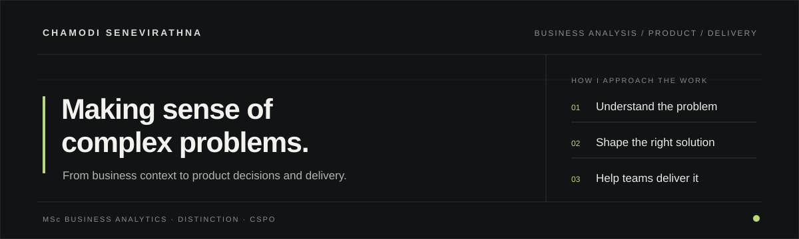

<!-- Chamodi Senevirathna | Profile -->

  

Most of my work starts with a practical question: what is actually getting in the way, and what would make it better?

I came to this through software engineering, then moved into business analysis, product work and business analytics. That path means I look at problems from both sides: the business process and the technology being built. I enjoy understanding how people work, making requirements concrete, weighing trade-offs and helping teams turn decisions into something useful.

My projects reflect that mix. Some explore product opportunities and business workflows; others are hands-on technical experiments, including one that uses a fruit-fly connectome to investigate whether a simplified neural model can learn a tiny Sudoku task. Different subjects, same habit: test the idea, examine the result and be clear about what the evidence does and doesn't show.

---

## Selected work

A portfolio of product questions, business systems and technical experiments. I group the work by the problem being explored, rather than by language or framework. New projects can be added to a category without renumbering or restructuring the rest of the page.

### Business systems & operations

<table>
  <tr>
    <td width="50%" valign="top">
      <strong><a href="https://github.com/chamodiHsenevirathna/autonomous-gtm">Autonomous GTM</a></strong>  
      A simulated end-to-end go-to-market workflow connecting lead research, qualification, CRM updates and follow-up, with people approving consequential actions.  
      GTM operations · Process design · Human oversight · Auditability
    </td>
  </tr>
</table>

### Product discovery & strategy

<table>
  <tr>
    <td width="50%" valign="top">
      <strong><a href="https://github.com/chamodiHsenevirathna/healthcare-ai-case-study">When AI predictions don't pay</a></strong>  
      A model can predict readmission risk. Can a hospital act on it, and does the economics make sense for the organisation paying?  
      Business viability · Incentives · Operational fit
    </td>
    <td width="50%" valign="top">
      <strong><a href="https://github.com/chamodiHsenevirathna/digital-financial-document-intelligence">Beyond chat with PDFs</a></strong>  
      Research into where document AI loses structure, evidence and trust in financial analysis workflows.  
      Workflow analysis · Problem framing · Evaluation
    </td>
  </tr>
  <tr>
    <td width="50%" valign="top">
      <strong><a href="https://github.com/chamodiHsenevirathna/digital-twin-oncology-case-study">Beyond trial and error</a></strong>  
      Which oncology use cases have enough evidence, a credible validation path and a reason to become a product?  
      Use-case prioritisation · Stakeholders · Risk
    </td>
    <td width="50%" valign="top">
      <strong><a href="https://github.com/chamodiHsenevirathna/local-first-reader-case-study">A local-first reading experience</a></strong>  
      Research into whether a private, account-free reading experience is compelling enough to justify building.  
      Product research · MVP scope · Feasibility
    </td>
  </tr>
</table>

### Prototypes & product experiments

<table>
  <tr>
    <td width="50%" valign="top">
      <strong><a href="https://github.com/chamodiHsenevirathna/brickwise">Brickwise</a></strong>  
      A working local prototype for visual product discovery. It learns from Like / Pass feedback to shape recommendations, rather than asking people to describe their taste in filters.  
      Product experience · Personalisation · Experimentation
    </td>
    <td width="50%" valign="top">
      <strong><a href="https://github.com/chamodiHsenevirathna/rag-evaluation-and-diagnostics">RAG evaluation & diagnostics</a></strong>  
      A space for experiments around evaluating retrieval-augmented generation systems and diagnosing failure modes.
    </td>
  </tr>
</table>

### AI, data & technical research

<table>
  <tr>
    <td width="50%" valign="top">
      <strong><a href="https://github.com/chamodiHsenevirathna/vlm-tumor-size-estimation">Can a vision-language model measure a tumour?</a></strong>  
      A research prototype investigating whether pixel spacing helps a VLM estimate physical tumour dimensions. The initial invalid run was withdrawn; corrected inference remains pending.  
      Evaluation design · Data quality · Risk controls
    </td>
    <td width="50%" valign="top">
      <strong><a href="https://github.com/chamodiHsenevirathna/speech-ai-evaluation">Speech AI evaluation</a></strong>  
      Research into local transcription, speech measurements and how coaching could be tied to evidence instead of invented feedback.  
      Measurement · Evaluation · Product research
    </td>
  </tr>
  <tr>
    <td width="50%" valign="top">
      <strong><a href="https://github.com/chamodiHsenevirathna/fruit-fly-connectome-explorer">Fruit Fly Connectome Explorer</a></strong>  
      An investigation into how changing connection-weight thresholds changes the ranking of neurons in a large connectome dataset.  
      Data analysis · Sensitivity analysis · Reproducibility
    </td>
    <td width="50%" valign="top">
      <a href="https://github.com/chamodiHsenevirathna?tab=repositories"><strong>Explore all public repositories ↗</strong></a>  
      Smaller experiments, new work and evolving projects live there too. Not every exploration needs a full case study.
    </td>
  </tr>
</table>

Evidence and project maturity vary. Some entries are desk-research investigations, not customer-validated products; others are prototypes or technical experiments. Each repository describes its own status, evidence and limitations. Private work is intentionally not linked here.

---

## The work behind the work

I enjoy connecting the perspectives that often get separated during delivery:

| From the business | Into the product | Through delivery |
|:--|:--|:--|
| Goals, users, processes, constraints | Problem statements, requirements, workflows, priorities | Backlogs, dependencies, QA, UAT and feedback |
| Commercial context and operational fit | Options, trade-offs and product decisions | Coordination across business and technical teams |

**Business analysis** — discovery, elicitation, process analysis, stakeholder alignment, user stories and acceptance criteria.

**Product** — problem framing, product research, prioritisation, MVP definition and evaluation.

**Delivery** — backlog refinement, cross-functional coordination, quality, UAT and issue resolution.

**Technology** — AI-enabled products, data workflows, APIs, Python, SQL and software product development.

## Background

**Education**

- MSc Business Analytics, Robert Gordon University — **Distinction**
- BSc Computer Science (Software Engineering), Curtin University

**Certifications & professional development**

- Microsoft Certified: AI Transformation Leader — 2026
- Certified Scrum Product Owner (CSPO) — 2025–2027
- Project Management Programme — 2023

---

  Based in Sri Lanka · Interested in thoughtful products, useful systems and questions that turn out to be harder than they first look.

